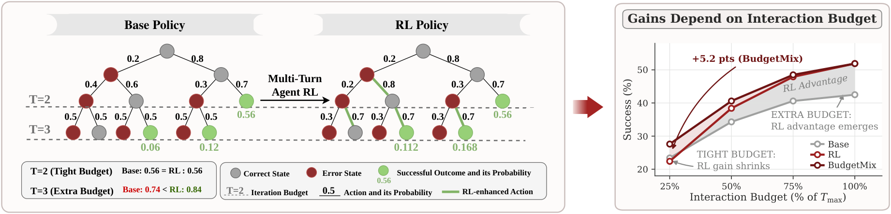
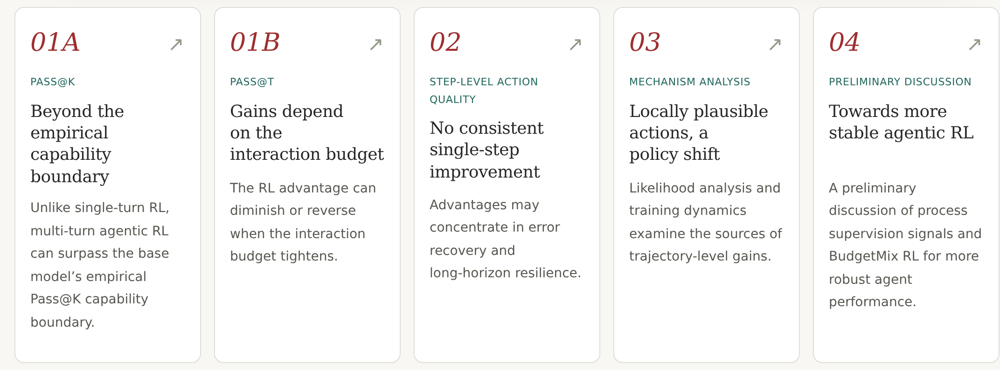

<div align="center">

<h1> Rethinking Agentic RL</h1>
<p><strong>What Does Multi-Turn Reinforcement Learning Really Improve in LLM Agents?</strong></p>

<p>
<a href="https://arxiv.org/abs/2608.03573"></a>
<a href="https://rethinking-agentic-rl.github.io/"></a>
<a href="LICENSE"></a>
<a href="pyproject.toml"></a>
<a href="https://github.com/GaryStack/Rethinking-Agent-RL/actions/workflows/ci.yml"></a>
</p>

<p>
<a href="#news">🎉 News</a> • <a href="#overview">📖 Overview</a> • <a href="#getting-started">🚀 Getting Started</a><br>
<a href="#choose-your-workflow">🧭 Choose Your Workflow</a> • <a href="#diagnostic-tools">🧰 Diagnostic Tools</a><br>
<a href="#repository-guide">🗂️ Repository Guide</a> • <a href="#citation">📝 Citation</a> • <a href="#contact">💬 Contact</a>
</p>
<p><a href="README.md">English</a> · <a href="README.zh-CN.md">中文</a></p>
</div>



<a id="news"></a>

## 🎉 News

- **2026-10-30** — Code, diagnostic tools, and tutorials are now public.

<a id="overview"></a>

## 📖 Overview

- **Pass@(K,T):** Multi-turn RL can surpass the base model’s empirical Pass@K boundary, but its advantage may diminish or reverse under tight turn budgets.
- **Single-step action quality:** RL does not consistently improve individual decisions; its advantages concentrate in error recovery and long-horizon resilience.
- **Towards more robust RL:** We discuss process supervision signals and introduce BudgetMix RL, which varies interaction budgets during training.

[](https://rethinking-agentic-rl.github.io/#overview)

This repository provides the accompanying method implementations and diagnostic tools. Its examples and engineering checks are not numerical reproductions of the paper benchmarks; see [method coverage](paper/coverage.md).

<a id="getting-started"></a>

## 🚀 Getting Started

From a source checkout, with Python 3.11 or newer:

```bash
git clone https://github.com/GaryStack/Rethinking-Agent-RL.git
cd Rethinking-Agent-RL
python -m pip install -e .
ard doctor --json
ard toolkit-demo --output runs/toolkit-walkthrough
```

Open `runs/toolkit-walkthrough/index.html` to explore five comparison reports:
budget-dependent success, matched-state quality, error-state quality, recovery,
and Base-monitor pool comparison. Every underlying run is audited before
reporting. The walkthrough also creates a BudgetMix sampling plan.

The demo uses **scripted policies**, including its Base/RL labels. After
installation, it needs no GPU, model weights, or network access. Use a fresh output
directory for each run. This demo does not validate training checkpoints.
See the [CPU walkthrough](docs/tutorials/offline-toolkit.md).

<a id="choose-your-workflow"></a>

### 🧭 Choose Your Workflow

| Your goal | Start here |
|---|---|
| Evaluate your own Base/RL checkpoints | [Model quickstart](docs/quickstart.md): HTTP chat endpoint or optional local Transformers backend |
| Compare existing agent versions | [JSONL trace tutorial](docs/tutorials/external-traces.md): matched-task success, token/time/cost coverage, original records, and an optional CI regression gate |
| Use Inspect evaluations or tool agents | [Inspect tutorial](docs/tutorials/inspect-agent.md): native `.eval`/JSON imports and an executable SQLite tool example |
| Study or extend the methods | [Paper companion](paper/README.md), [protocols](docs/protocols.md), and [custom scorer example](docs/extensions.md) |

Core evaluation and JSONL analysis use only the Python standard library.
Local Transformers inference, Inspect, and training integrations are optional.

<a id="diagnostic-tools"></a>

## 🧰 Diagnostic Tools

| Tool | Question it answers | Entry and tutorial |
|---|---|---|
| **Tight-budget evaluation** | How does success change with sampling breadth K and turn budget T? | `ard eval budget`, `ard compare` · [Tutorial](docs/tutorials/tight-budget.md) |
| **Error-prefix evaluation** | From the same state and remaining budget, which policy makes better decisions and recovers more often? | `ard pool errors`, `ard eval step`, `ard eval recovery` · [Tutorial](docs/tutorials/error-prefix.md) |
| **Training dynamics** | Do trajectory success and fixed-state decision quality improve together across checkpoints? | `ard eval checkpoint`, `ard dynamics` · [Tutorial](docs/tutorials/training-dynamics.md) |
| **BudgetMix RL** | What happens when training groups receive different, explicitly visible turn budgets? | `ard budgetmix plan/audit`, optional pinned VeRL adapter · [Tutorial](docs/tutorials/budgetmix.md) |

Two additional method paths are available:

- **Likelihood / NLL / LLR:** teacher-forced response likelihood, action-token NLL, aligned Base/RL log-likelihood ratios, and length controls. [Inputs and commands](docs/likelihood.md).
- **Process signals:** oracle or judge scores, versioned caching, explicit reward mixing, and a runnable reward-to-update example. [Method and trainer integration](docs/process-signals.md).

Comparisons reuse frozen inputs and recorded protocols. Reports retain missing
samples and infrastructure failures rather than silently treating them as task
failures or successes. Historical trace imports preserve caller-reported outcomes;
they do not establish controlled recovery or independently verify task success.

<a id="repository-guide"></a>

## 🗂️ Repository Guide

| Path | Contents |
|---|---|
| [`src/agent_rl_diagnostics/`](src/agent_rl_diagnostics/) | Metrics, evaluators, frozen pools, analysis, reporting, and optional integrations |
| [`configs/examples/`](configs/examples/) | Evaluation and backend configuration examples |
| [`examples/`](examples/) | Likelihood fixtures, process reward updates, external traces, and tool-agent examples |
| [`docs/tutorials/`](docs/tutorials/) | Runnable workflows for the four tools and external data |
| [`paper/`](paper/) | Mapping from research methods to code and verification scope |

For development:

```bash
python -m pip install -e '.[dev]'
python -m pytest -q
ruff check .
ruff format --check src tests scripts examples
```

Contributions are welcome; see [CONTRIBUTING.md](CONTRIBUTING.md).
Preview changes and publishing steps are in the [changelog](CHANGELOG.md) and
[release guide](docs/release.md).

<a id="citation"></a>

## 📝 License and Citation

Original code is released under the [MIT license](LICENSE). Third-party assets
retain their own terms; see [NOTICE](NOTICE). Model weights, private benchmark
tests, original traces, and full experiment results are not bundled.

Software citation metadata is in [CITATION.cff](CITATION.cff).
Final author and paper citation metadata will be added when finalized.

<a id="contact"></a>

## 💬 Contact

For questions and feedback, please open an [issue](https://github.com/GaryStack/Rethinking-Agent-RL/issues).
