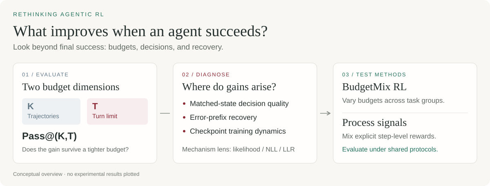

<div align="center">

<h1>Rethinking Agentic RL</h1>

<p><strong>What does multi-turn reinforcement learning really improve in LLM agents?</strong></p>
<p>Evaluate across interaction budgets. Diagnose decisions and recovery. Test BudgetMix RL.</p>

<p>
  <a href="#overview">Overview</a> ·
  <a href="#quickstart">Quickstart</a> ·
  <a href="#diagnostic-tools">Tools</a> ·
  <a href="paper/README.md">Method coverage</a> ·
  <a href="README.zh-CN.md">中文</a>
</p>

<p>Python 3.11+ · Standard-library core · MIT · Development preview</p>

</div>



## Overview

A higher final success rate leaves an important question unanswered: **did the
agent make better decisions, or did it become better at recovering over more turns?**
This work studies multi-turn agentic RL through both sampling breadth **K** and
interaction depth **T**, using **Pass@(K,T)**: the probability that at least one of
K sampled trajectories succeeds within T interaction turns.

The accompanying study highlights three observations:

- **Gains depend on the budget.** Trajectory-level advantages can shrink or reverse when interaction budgets tighten.
- **Step-level improvements are uneven.** RL's strengths concentrate in error recovery and later stages of long-horizon trajectories.
- **Local and trajectory-level behavior can diverge.** Likelihood analysis and checkpoint monitoring help examine how locally plausible actions compose into successful trajectories.

These observations motivate **BudgetMix RL**, which varies interaction budgets
across training task groups, alongside an exploration of process-supervision signals.

This repository provides the **Agent RL Diagnostics** package (`ard`): method
implementations, reusable diagnostic tools, and small runnable examples. The study
findings above are research context; the examples and engineering checks here do
not reproduce the paper's benchmark numbers. See [method coverage](paper/coverage.md).

## Quickstart

From a source checkout, with Python 3.11 or newer:

```bash
git clone https://github.com/GaryStack/Rethinking-Agent-RL.git
cd Rethinking-Agent-RL
python -m pip install -e .
ard doctor --json
ard toolkit-demo --output runs/toolkit-walkthrough
```

Open `runs/toolkit-walkthrough/index.html` to explore five comparison reports:
budget-dependent success, matched-state quality, error-state quality, recovery,
and Base-monitor pool comparison. Every underlying run is audited before
reporting. The walkthrough also creates a BudgetMix sampling plan.

The demo uses **scripted policies**, including its Base/RL labels. After
installation, it needs no GPU, model weights, or network access. Use a fresh output
directory for each run. This demo does not validate training checkpoints.
See the [CPU walkthrough](docs/tutorials/offline-toolkit.md).

### Choose your workflow

| Your goal | Start here |
|---|---|
| Evaluate your own Base/RL checkpoints | [Model quickstart](docs/quickstart.md): HTTP chat endpoint or optional local Transformers backend |
| Compare existing agent versions | [JSONL trace tutorial](docs/tutorials/external-traces.md): matched-task success, token/time/cost coverage, original records, and an optional CI regression gate |
| Use Inspect evaluations or tool agents | [Inspect tutorial](docs/tutorials/inspect-agent.md): native `.eval`/JSON imports and an executable SQLite tool example |
| Study or extend the methods | [Paper companion](paper/README.md), [protocols](docs/protocols.md), and [custom scorer example](docs/extensions.md) |

Core evaluation and JSONL analysis use only the Python standard library.
Local Transformers inference, Inspect, and training integrations are optional.

## Diagnostic tools

| Tool | Question it answers | Entry and tutorial |
|---|---|---|
| **Tight-budget evaluation** | How does success change with sampling breadth K and turn budget T? | `ard eval budget`, `ard compare` · [Tutorial](docs/tutorials/tight-budget.md) |
| **Error-prefix evaluation** | From the same state and remaining budget, which policy makes better decisions and recovers more often? | `ard pool errors`, `ard eval step`, `ard eval recovery` · [Tutorial](docs/tutorials/error-prefix.md) |
| **Training dynamics** | Do trajectory success and fixed-state decision quality improve together across checkpoints? | `ard eval checkpoint`, `ard dynamics` · [Tutorial](docs/tutorials/training-dynamics.md) |
| **BudgetMix RL** | What happens when training groups receive different, explicitly visible turn budgets? | `ard budgetmix plan/audit`, optional pinned VeRL adapter · [Tutorial](docs/tutorials/budgetmix.md) |

Two additional method paths are available:

- **Likelihood / NLL / LLR:** teacher-forced response likelihood, action-token NLL, aligned Base/RL log-likelihood ratios, and length controls. [Inputs and commands](docs/likelihood.md).
- **Process signals:** oracle or judge scores, versioned caching, explicit reward mixing, and a runnable reward-to-update example. [Method and trainer integration](docs/process-signals.md).

Comparisons reuse frozen inputs and recorded protocols. Reports retain missing
samples and infrastructure failures rather than silently treating them as task
failures or successes. Historical trace imports preserve caller-reported outcomes;
they do not establish controlled recovery or independently verify task success.

## Support and verification

Current preview: **`0.1.0.dev11`**.

| Area | Current scope |
|---|---|
| Executable environments | Deterministic FrozenLake and derived stdin/stdout coding; coding requires the bounded Linux namespace executor |
| External data | Generic JSONL and optional Inspect logs; BFCL, SQL, and Terminal are external analysis inputs, with no bundled benchmark environments |
| Training integrations | Pinned VeRL paths with limited one-rank acceptance; full PPO/GiGPO training, multi-rank execution, and optimizer resume remain unverified |
| Paper reproduction | Method code is available; full benchmark numerical reproduction remains unverified |

The latest CPU regression recorded **333 passed, 4 skipped**; the optional Inspect
acceptance separately recorded **27 passed**. Real **Qwen3-1.7B** one-rank
Ray/vLLM/FSDP engineering checks include BudgetMix and two process-enabled
REINFORCE++ updates. These establish the documented execution paths, not method
effectiveness. The seeded diagnostic off/on pair still diverges in one rollout
and second-update state; complete trainer noninterference remains unverified.

See [current status](STATUS.md), [support matrix](docs/support-matrix.md),
[preview verification](docs/verification/dev11.md), and
[GPU process verification](docs/verification/process-gpu.md) for details.

## Repository guide

| Path | Contents |
|---|---|
| [`src/agent_rl_diagnostics/`](src/agent_rl_diagnostics/) | Metrics, evaluators, frozen pools, analysis, reporting, and optional integrations |
| [`configs/examples/`](configs/examples/) | Evaluation and backend configuration examples |
| [`examples/`](examples/) | Likelihood fixtures, process reward updates, external traces, and tool-agent examples |
| [`docs/tutorials/`](docs/tutorials/) | Runnable workflows for the four tools and external data |
| [`paper/`](paper/) | Mapping from research methods to code and verification scope |

For development:

```bash
python -m pip install -e '.[dev]'
python -m pytest -q
ruff check .
ruff format --check src tests scripts examples
```

Contributions are welcome; see [CONTRIBUTING.md](CONTRIBUTING.md).
Preview changes and publishing steps are in the [changelog](CHANGELOG.md) and
[release guide](docs/release.md).

## License and citation

Original code is released under the [MIT license](LICENSE). Third-party assets
retain their own terms; see [NOTICE](NOTICE). Model weights, private benchmark
tests, original traces, and full experiment results are not bundled.

Software citation metadata is in [CITATION.cff](CITATION.cff).
Author names and the paper link will be added when finalized.
