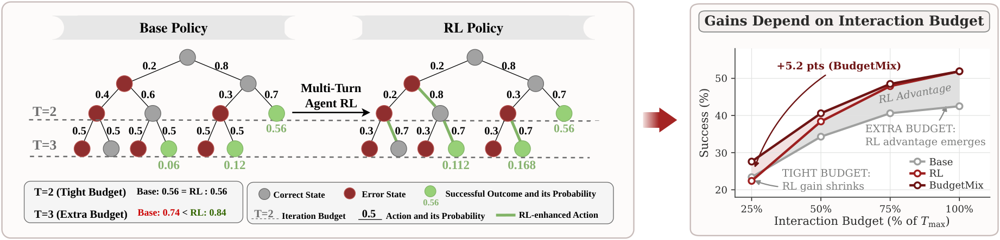
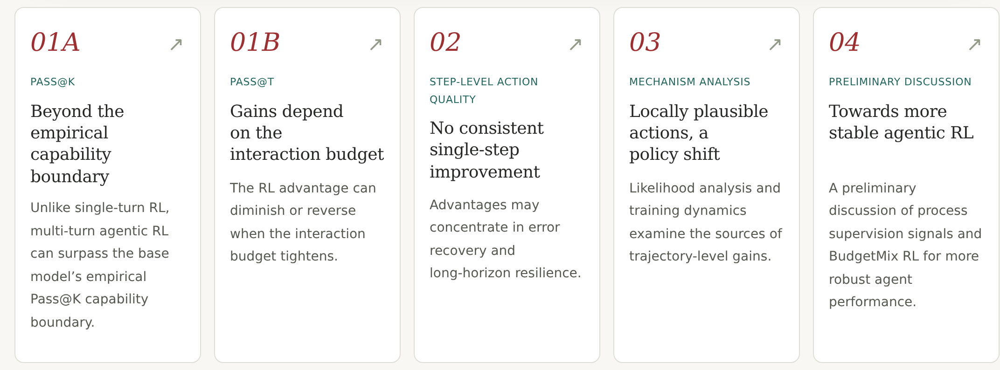

<div align="center">

<h1> Rethinking Agentic RL</h1>
<p><strong>What Does Multi-Turn Reinforcement Learning Really Improve in LLM Agents?</strong></p>

<p>
<a href="https://arxiv.org/abs/2608.03573"></a>
<a href="https://rethinking-agentic-rl.github.io/"></a>
<a href="LICENSE"></a>
<a href="pyproject.toml"></a>
<a href="https://github.com/GaryStack/Rethinking-Agent-RL/actions/workflows/ci.yml"></a>
</p>

<p>
<a href="#news">🎉 News</a> • <a href="#overview">📖 Overview</a> • <a href="#getting-started">🚀 Getting Started</a><br>
<a href="#choose-your-workflow">🧭 Choose Your Workflow</a> • <a href="#diagnostic-tools">🧰 Diagnostic Tools</a><br>
<a href="#repository-guide">🗂️ Repository Guide</a> • <a href="#citation">📝 Citation</a> • <a href="#contact">💬 Contact</a>
</p>
<p><a href="README.md">English</a> · <a href="README.zh-CN.md">中文</a></p>
</div>



<a id="news"></a>

## 🎉 News

- **2026-10-30** — 代码、诊断工具和使用教程已开源。

<a id="overview"></a>

## 📖 研究概览

多轮 agentic 强化学习（RL）在长程任务上表现突出，但其性能收益对**交互约束高度敏感**。我们通过 **Pass@(K,T)**，从采样广度 **K** 和交互深度 **T** 两个维度进行评测，发现轨迹级 RL 优势依赖充足的交互预算，预算收紧时收益显著减弱。此外，agentic RL 并未一致提升单步决策质量，其优势更集中于**错误恢复和长程鲁棒性**。 为缓解这种预算依赖带来的部署风险，我们初步讨论过程监督信号的收益与局限，并提出 **BudgetMix RL**，在训练中改变交互预算。论文实验表明，BudgetMix RL 在不同执行设置下具有稳健表现。

- **Pass@(K,T)：** 多轮 RL 可以超越基础模型的经验 Pass@K 能力边界，但在较紧的交互预算下，优势可能缩小甚至反转。
- **单步动作质量：** RL 并未一致提升单步决策，其优势更集中在错误恢复和长程鲁棒性。
- **改进方法讨论：** 我们讨论过程监督信号，并提出训练时改变交互预算的 BudgetMix RL。

[](https://rethinking-agentic-rl.github.io/#overview)

本仓库提供论文方法实现与诊断工具；示例和工程测试不代表论文 benchmark 数值复现。详见[方法覆盖](paper/coverage.md)。

<a id="getting-started"></a>

## 🚀 快速开始

在源码仓库根目录运行，要求 Python 3.11 或更新版本：

```bash
git clone https://github.com/GaryStack/Rethinking-Agent-RL.git
cd Rethinking-Agent-RL
python -m pip install -e .
ard doctor --json
ard toolkit-demo --output runs/toolkit-walkthrough
```

打开 `runs/toolkit-walkthrough/index.html`，查看五份对比报告：预算下的成功率、
同状态单步质量、错误状态单步质量、续跑恢复，以及固定 Base 池对比。
底层运行记录经过审计后才生成报告；示例还会生成一份 BudgetMix 采样计划。

示例使用**脚本策略**，Base/RL 标签不代表训练后的模型。安装完成后无需 GPU、模型权重或网络。
每次运行请使用新的输出目录。这个演示不验证训练 checkpoint，详见 [CPU 完整教程](docs/tutorials/offline-toolkit.md)。

<a id="choose-your-workflow"></a>

### 🧭 选择你的使用入口

| 你的目标 | 从这里开始 |
|---|---|
| 评测自己的 Base/RL checkpoint | [模型 quickstart](docs/quickstart.md)：HTTP chat 服务，或可选的本地 Transformers backend |
| 比较已有 Agent 版本 | [JSONL 日志教程](docs/tutorials/external-traces.md)：同任务成功率、token/耗时/费用覆盖、原始记录和可选 CI 回归门槛 |
| 接入 Inspect 或工具智能体 | [Inspect 教程](docs/tutorials/inspect-agent.md)：原生 `.eval`/JSON 导入和可执行 SQLite 工具示例 |
| 查看论文实现 | [论文配套代码](paper/README.md) |

核心评测和 JSONL 分析仅依赖 Python 标准库；本地 Transformers 推理、Inspect 和训练接入均为可选依赖。

<a id="diagnostic-tools"></a>

## 🧰 诊断工具

用于分析和诊断 agentic RL 训练的工具。

| 工具 | 回答什么问题 | 入口与教程 |
|---|---|---|
| **Tight-budget evaluation** | 成功率如何随采样次数 K 和交互预算 T 变化？ | `ard eval budget`、`ard compare` · [教程](docs/tutorials/tight-budget.md) |
| **Error-prefix evaluation** | 在相同状态和剩余预算下，哪个策略决策更好、更容易恢复？ | `ard pool errors`、`ard eval step`、`ard eval recovery` · [教程](docs/tutorials/error-prefix.md) |
| **Training dynamics** | 不同 checkpoint 的轨迹成功率和固定状态决策质量是否同步改善？ | `ard eval checkpoint`、`ard dynamics` · [教程](docs/tutorials/training-dynamics.md) |
| **BudgetMix RL** | 训练任务组使用不同且对模型可见的交互预算，会发生什么？ | `ard budgetmix plan/audit`、可选的锁定 VeRL adapter · [教程](docs/tutorials/budgetmix.md) |

另外提供两条方法分析与测试路径：

- **Likelihood / NLL / LLR：** teacher-forced response likelihood、动作 token NLL、对齐后的 Base/RL 对数似然比和长度控制。[输入与命令](docs/likelihood.md)。
- **Process signals：** oracle/judge 评分、版本化缓存、显式奖励混合，以及可运行的奖励到参数更新示例。[方法与训练接入](docs/process-signals.md)。

<a id="repository-guide"></a>

## 🗂️ 仓库导航

| 路径 | 内容 |
|---|---|
| [`src/agent_rl_diagnostics/`](src/agent_rl_diagnostics/) | 指标、评测器、冻结状态池、分析、报告与可选接入 |
| [`configs/examples/`](configs/examples/) | 评测与 backend 配置示例 |
| [`examples/`](examples/) | Likelihood 输入、过程奖励更新、外部日志和工具智能体示例 |
| [`docs/tutorials/`](docs/tutorials/) | 四个工具与外部数据的可运行教程 |
| [`paper/`](paper/) | 论文实现与方法 |

开发检查：

```bash
python -m pip install -e '.[dev]'
python -m pytest -q
ruff check .
ruff format --check src tests scripts examples
```

<a id="citation"></a>

## 📝 许可证与引用

原创代码采用 [MIT 许可证](LICENSE)，第三方资产保留各自条款，见 [NOTICE](NOTICE)。
仓库不包含模型权重、私有 benchmark 测试、原始轨迹或完整实验结果。

软件引用元数据见 [CITATION.cff](CITATION.cff)，最终作者与论文引用元数据待确认后补充。

<a id="contact"></a>

## 💬 Contact

欢迎通过 [issue](https://github.com/GaryStack/Rethinking-Agent-RL/issues).
